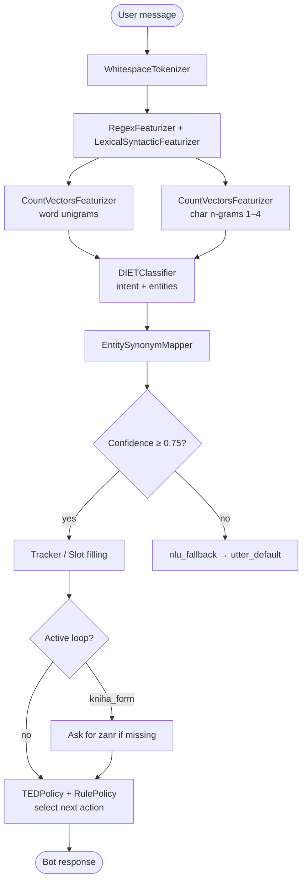

# rasa_knihobot — Czech Virtual Bookstore Assistant

A Czech-language conversational assistant for a fictional bookstore, built on Rasa Open Source. The user types something like *"Hledám dobrou detektivku"* ("I'm looking for a good detective novel") and the bot works through a short dialogue to nail down genre, then returns hardcoded bestseller recommendations along with answers to stock and pricing questions.

The interesting constraint here isn't the dialogue itself — that's a handful of stories and a single-slot form. The interesting constraint is the language. Czech is morphologically rich: the same word changes its ending depending on grammatical case, and there's no transformer-based Czech NLU model bundled with Rasa out of the box. So the whole NLU pipeline has to work from scratch using n-grams, and making that reliable enough to be useful took more tuning than the dialogue logic did.

## Why this exists

This is a university assignment for the *UI a její aplikace* course — but the implementation choices were real ones, not just "make it work for the demo."

The specific question I kept coming back to: **how far can you get with a purely statistical pipeline on a morphologically complex language, without reaching for a pre-trained language model?** The answer, for a tightly scoped domain, is: pretty far. Intent classification sits at ~94.5% accuracy on the test set. Story accuracy is ~89.2%. That's not production-grade, but for a bot that only needs to handle eight intents in a vocabulary-constrained domain, it's solid enough that the failure modes are interesting rather than embarrassing.

## How it works

The flow has two distinct phases — understanding what the user said, and deciding what to do next:



**NLU pipeline.** The tokenizer splits on whitespace — crude, but Czech compounds are mostly space-separated so it holds. Two CountVectorisers run in parallel: one over whole words, one over character n-grams (length 1–4). The character n-gram featuriser is the load-bearing piece here: it lets the classifier generalise across inflected forms without needing a lemmatiser. `DIETClassifier` handles both intent classification and entity extraction in a single pass. A `FallbackClassifier` sits at the end with a confidence threshold of 0.75 — anything below that gets routed to a generic fallback response rather than a wrong answer.

**Entities.** Five entity types are extracted: `zanr` (genre), `typ_vazby` (binding format), `jazyk_knihy` (language), `autor` (author), and `vydavatelstvo` (publisher). Of these, only `zanr` is actually required downstream — it's the single required slot in `kniha_form`. The others are extracted and stored in slots, but the bot's responses don't branch on them. That's a known limitation, not an oversight; see *What I'd do next*.

**EntitySynonymMapper** handles the heavy lifting of Czech morphology at the entity level: "detektivka", "detektivku", "detektivce", "kriminálka" all normalise to `detektivku`; "audioknihy", "mluvené slovo", "kniha na poslech" all map to `audioknihu`. Without this, the form would break on any inflected form it hadn't seen in training.

**Dialogue management.** `RulePolicy` handles the deterministic paths — greet always triggers the greeting + menu, farewell always closes the session, price and availability questions always get direct answers. `TEDPolicy` and `UnexpecTEDIntentPolicy` handle the messier stuff: genre changes mid-conversation, skipped greetings, consent/refusal patterns. Max history is 5 turns for both.

## Tech stack

- **Rasa Open Source 3.x** — NLU + dialogue
- **Python 3.x** — actions server (scaffolded; no custom actions currently running)
- **YAML** — everything else: NLU training data, stories, rules, domain, config

No database, no external API calls, no custom action logic. All responses are static strings defined in `domain.yml`.

## Running it

```bash
git clone <this-repo>
cd rasa_knihobot

# create and activate a virtual environment
python -m venv venv && source venv/bin/activate

# install Rasa (check rasa.com/docs for the exact version constraint)
pip install rasa

# train the model
rasa train

# run the assistant in the terminal
rasa shell
```

If you want to run with a custom actions server (needed if you add action logic later):

```bash
# in one terminal
rasa run actions

# in another
rasa run --enable-api
```

The `endpoints.yml` already points to `http://localhost:5055/webhook` for the action server.

## Project layout

```
rasa_knihobot/
├── data/
│   ├── nlu.yml          # training examples + synonym definitions
│   ├── stories.yml      # multi-turn conversation paths
│   └── rules.yml        # deterministic single-turn rules
├── actions/
│   └── actions.py       # custom action scaffold (currently empty)
├── results/             # evaluation output from rasa test
├── tests/
│   ├── test_nlu.yml
│   └── test_stories.yml
├── domain.yml           # intents, entities, slots, forms, responses
├── config.yml           # pipeline + policy configuration
└── endpoints.yml        # action server connection
```

The separation between `rules.yml` and `stories.yml` is deliberate: rules encode what must always happen (greet → respond, farewell → close), stories encode what typically happens. Mixing them would make the policy harder to debug.

## Evaluation results

Run via `rasa test` against the held-out test sets in `/tests`:

| Metric | Score |
|---|---|
| Intent accuracy | 94.5 % |
| Intent macro F1 | 93.9 % |
| Story accuracy | 89.2 % |

The weakest intents are `rozlouceni` (farewell) and `souhlas` (agreement) — both bleed into `pozdrav` (greeting) because short affirmative and closing phrases share surface features. More training examples with varied phrasing would tighten this.

## What I'd do next

A few things left out on purpose to keep the scope bounded:

- **Actually use the extracted entities in responses.** Right now `autor`, `vydavatelstvo`, `typ_vazby`, and `jazyk_knihy` are extracted and slotted but ignored when composing the reply. A proper version would at minimum filter the hardcoded recommendations by binding type if the user specified e-book or audiobook.

- **Real book data.** The recommendations are three titles hardcoded as a string in `domain.yml`. Hooking up even a static JSON catalogue through a custom action would make the bot immediately more useful and demonstrate the actions server pattern properly.

- **Lemmatisation or a morphological analyser.** The char n-gram trick works for training-set coverage but will still fail on unseen inflected forms outside the synonym map. Plugging in something like `stanza` or `majka` as a custom tokeniser component would make the NLU meaningfully more robust for Czech.

- **More NLU training data.** 9–22 examples per intent is enough to train, but it's thin. The `rozlouceni` / `souhlas` confusion would likely disappear with another 20 examples each.

- **Connector integration.** The `credentials.yml` is scaffolded for multiple channels (REST, socket.io) but none are configured. Wiring this to a simple frontend — even a plain HTML page — would make testing substantially less painful than `rasa shell`.

## Status

University project; works, tests pass, architecture is clean. Not a product.

The NLU pipeline is the part worth borrowing from — the n-gram approach to Czech morphology is a reasonable baseline if you're building a domain-specific Czech bot and don't want the overhead of a full transformer stack.

---

*Built by Jan Vrzal and Matěj Fadrhons · [github.com/janvrzal](https://github.com/janvrzal) · [github.com/mFadr](https://github.com/mFadr)*
